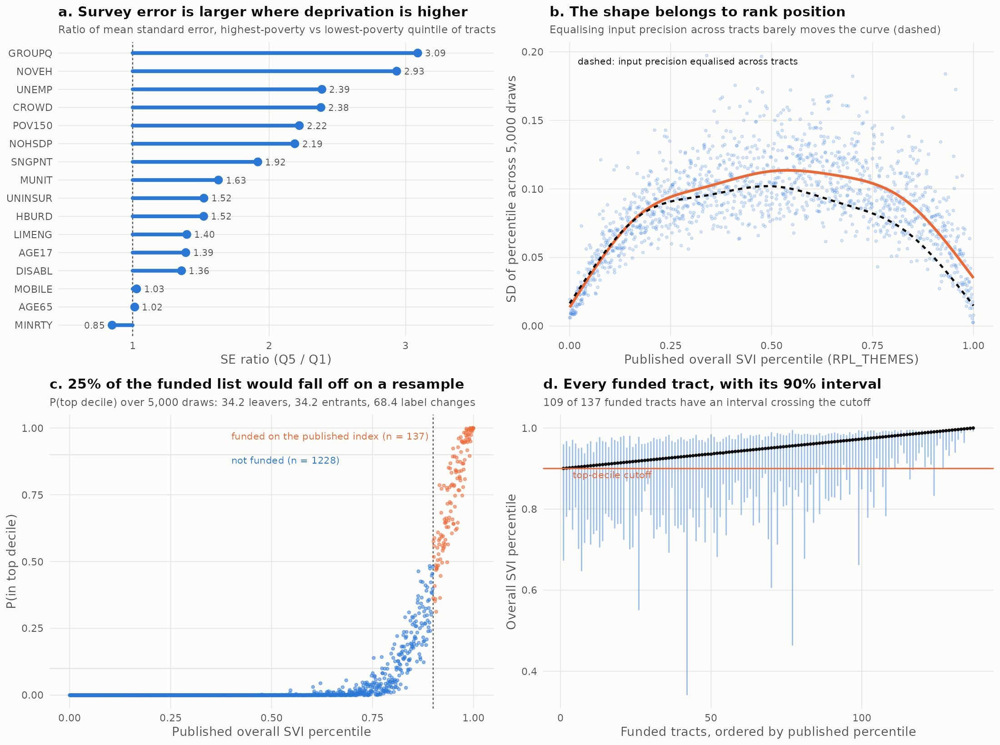

# Composite Indices as Policies

**How reliable are the scores used to allocate public resources?**

[](https://github.com/blam3/composite-indices-as-policies/actions/workflows/r-cmd-check.yml)
[](https://github.com/blam3/composite-indices-as-policies/actions/workflows/checks.yml)

The [Social Vulnerability Index](https://svi.cdc.gov/) (SVI) is calculated for each census tract in the United 
States, and quantifies how susceptible a community is to stressors and public health 
emergencies. The SVI has been used to guide and allocate funding across 
federal, state, and local programs, including disaster recovery, public health, and 
municipal support. The index is built from American Community Survey estimates, and every one of those estimates has a margin of error.

**This project studies how sampling uncertainty in the American Community Survey
data propagates through the CDC/ATSDR Social Vulnerability Index and
changes which census tracts qualify for funding under hypothetical allocation thresholds.**
It connects measurement error to decisions that an index could induce.

**Methods:** R; public-data reconstruction; variance replicates; Monte Carlo
simulation; uncertainty propagation; descriptive subgroup analysis



## What I found
 
I rebuilt the SVI 2022 from the Census Bureau's raw variance replicate tables, matched CDC's published file to the last digit, and then re-ran the entire index 5,000 times under the survey's own sampling error. Two states so far, chosen to be as different as possible: Louisiana (1,379 tracts, urban and coastal) and Wyoming (160 tracts, small and rural).
 
**1. Roughly one in four funded tracts is funded by luck of the draw.** Under a rule that funds the top tenth of tracts, a different but equally valid survey sample would, in expectation, push 24.9% of Louisiana's funded tracts out of the funded set (34 of 137) and 26.6% of Wyoming's (4.3 of 16), with as many unfunded tracts moving in. A typical tract's rank is uncertain by 29 percentile points (Louisiana) to 36 points (Wyoming), measured as the width of a 90% interval.
 
**2. Poorer places are measured worse, and the ranking hides it.** In Louisiana, the sampling error on seven of the sixteen inputs is 1.9 to 3.1 times larger in the poorest fifth of tracts than in the richest fifth. Yet a tract's poverty level barely predicts how noisy its final rank is: poverty and four other tract characteristics together explain under 3% of the variation in Louisiana, against 59% for rank position alone. The percentile-ranking step takes unequal precision in and puts out noise that looks like a function of where a tract sits on the list. I call this *precision laundering*: the inequity is real, it reaches the funding decision, and the published number gives no trace of it.
 
**3. That hidden inequity has a measurable price.** A counterfactual experiment gives every tract the same input precision while holding everything else fixed. The funded set's rank noise falls by a factor of about 1.5 in both states, and the churn rate at the top-decile cutoff falls from 25.0% to 20.2% in Louisiana and from 27.1% to 22.5% in Wyoming. So roughly a fifth (Louisiana) to a sixth (Wyoming) of the decision instability comes specifically from the fact that the survey measures some communities less precisely than others.
 
Every number above is a field in a machine-readable results manifest ([Louisiana](analysis/louisiana/results/EXPECTED-RESULTS.json), [Wyoming](analysis/wyoming/results/EXPECTED-RESULTS.json)) that the pipeline regenerates and checks itself against.
 
## Why this matters beyond one index
 
The same structure appears wherever a score built by adding up noisy parts is cut at a threshold to decide who gets something: HUD's Qualified Census Tracts for housing tax credits, FEMA's National Risk Index, school funding formulas, and, increasingly, aggregate safety and capability scores used to decide whether an AI system is fit to deploy. In each case three questions apply, and they are rarely asked:
 
- **Reliability.** Would the decision survive a fresh draw of the data? (This repository answers this for SVI.)
- **Fairness.** Does the score predict harm equally well across groups and regions, and is its error spread evenly?
- **Transport.** Does a rule that worked where it was designed still work in the jurisdiction, or deployment population, that adopts it?
The full research program, with five workpackages, is in [docs/program.md](docs/program.md).
 
| Workpackage | Question | Status |
|---|---|---|
| WP1 Decision reliability | How much of the ranking is survey noise, and who bears it? | **Done for two states; paper in preparation** |
| WP2 Differential prediction | Does SVI predict disaster aid outcomes equally across groups? | Tract-linked FEMA outcome data located and confirmed public; analysis not started |
| WP3 Safe policy learning under transport | Does a guarantee about an allocation rule survive moving it to a new place? | Theory note drafted; anchored on the LIHTC Qualified Census Tract rule |
| WP4 Whose weights? | Do equal, outcome-optimal and community-chosen weights fund the same places? | Planned |
| WP5 Composite scores in AI evaluation | Are aggregate AI safety scores composites mistaken for measurements? | Planned |
 
## What has been built
 
- **An exact public reconstruction of a federal index.** 57,368 of 57,368 published Louisiana values and 6,678 of 6,678 Wyoming values reproduced exactly, along with every missing-data cell. Getting there required reverse-engineering three undocumented conventions in CDC's code (SAS-style rounding, the tie-breaking rule in the percentile rank, and re-rounding between summing and ranking).
- **`svichurn`, an R package.** One function, `composite_churn()`, takes replicate estimates and a description of any normalize-weight-sum-threshold index and returns each unit's probability of entering or leaving the funded set. It ships the SVI 2022 rule as a tested specification. A regression test reproduces CDC's published Louisiana ranks with no tolerance, and fails if the tie rule is changed. `R CMD check --as-cran` runs in CI.
- **A prediction made before the data.** The expected Wyoming results were written down and committed ([prediction](docs/wp1-wyoming-prediction.md)) before any Wyoming data were downloaded, then scored against what came back, misses included ([findings and scorecard](docs/wp1-wyoming-findings.md)). The core claim held; five specific predictions did not, and the findings say which.
- **Self-checking reproduction.** `run_all.sh` fingerprints the inputs, reruns the full chain, and diffs every output against the committed manifest; a full Louisiana rerun on a newer R version (4.5.2, against the original 4.3.3) matched exactly.
- **An audit trail.** The [audit response](docs/wp1-audit-response.md), the [line-by-line check of all sixteen ACS table mappings](docs/wp1-line-number-verification.md), and a [living status file](docs/STATUS.md) that records corrections and retracted claims rather than overwriting them.
## Try it
 
```r
# install.packages("remotes")
remotes::install_github("blam3/composite-indices-as-policies")
library(svichurn)
 
# num, den: arrays [unit x component x (1 + 80 replicates)] of ACS counts
out <- composite_churn(num, den,
                       spec = list(comp_var = comp_var, themes = themes,
                                   aggregate = "rank", threshold = 0.90),
                       B = 5000)
attr(out, "churn")   # expected leavers, entrants and leaver rate per threshold
```
 
The [Louisiana vignette](vignettes/louisiana.Rmd) runs this on the frozen Louisiana inputs and checks the result against the manifest to eight decimal places. To swap in a different index, change the variable list, themes, weights or threshold.
 
## Reproduce the full analysis
 
Requirements: R (≥ 4.1) with `data.table`, `ggplot2`, `dplyr`, `gridExtra` and `jsonlite`; Python 3 (standard library only, for input fingerprinting and manifest comparison); `unzip`. The raw Census files are not committed; [data/README.md](data/README.md) gives the official sources and exact layout.
 
```bash
git clone https://github.com/blam3/composite-indices-as-policies.git
cd composite-indices-as-policies
bash analysis/louisiana/run_all.sh   # ~18 min at B = 5,000
bash analysis/wyoming/run_all.sh     # ~3 min
make check                           # lightweight checks, no data needed
```
 
A run passes only if it reproduces 100% of published values and missingness, deterministic outputs match within 1e-9, and Monte Carlo outputs (same seed and draw count) match within 2%. Otherwise the script exits with an error. Local outputs are git-ignored, so a run never overwrites the reference.
 
## How this relates to prior work
 
Uncertainty in social vulnerability rankings has been studied before, notably by [Tate (2013)](https://doi.org/10.1080/00045608.2012.700616). Two 2026 papers propagate ACS sampling error through SVI-style indices: [Saba & Ash](https://doi.org/10.1371/journal.pone.0354333) simulate from published margins of error across eight states, and [Feldmeyer, Folch & Tate](https://link.springer.com/article/10.1007/s11205-026-03827-7) use variance replicates and also find larger uncertainty in more vulnerable places. This project's contribution is at the decision rather than the score: an exact reproduction of the published index, churn measured at funding thresholds, the finding that ranking hides unequal precision, and a counterfactual that prices that inequity in funding decisions.
 
## What this does not show
 
The allocation rules here are hypothetical thresholds, not a specific grant program, so the results do not show that any actual award went to the wrong place. They are simulations under a stated sampling-error model, not repeated real surveys. Associations between tract characteristics and rank noise are descriptive. Whether SVI predicts the harms it is meant to target is WP2's question and is not answered here.
 
## Repository map
 
- `R/`, `tests/`, `vignettes/`: the `svichurn` package
- `analysis/<state>/code/`: reconstruction, simulation, decision and subgroup analysis, figures
- `analysis/<state>/results/`: committed manifest, figure and tract-level outputs
- `scripts/`: input fingerprinting and manifest comparison
- `docs/`: program, findings, prediction, audit and status
## Author, license and citation
 
Brendan Lam, Yale University. Code assistance from Claude and Codex is recorded in the [audit response](docs/wp1-audit-response.md) and [STATUS](docs/STATUS.md); all research decisions and conclusions are the author's.
 
Code: [MIT](LICENSE.md). Prose and figures: [CC BY 4.0](LICENSE-docs). Cite via [CITATION.cff](CITATION.cff).
